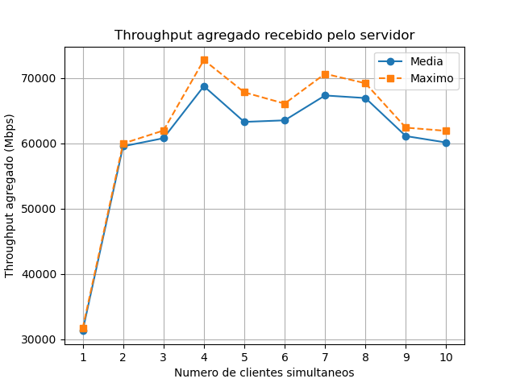

# Chat TCP: teste de capacidade de transmissão

Trabalho da disciplina Redes de Computadores (Unifesp), professor Arlindo Flávio da Conceição.

Este repositório contém o cliente e o servidor de um chat TCP em C, modificados para medir a taxa de transmissão agregada dos clientes para o servidor, com 1 a 10 clientes simultâneos.

## Integrantes

| Nome | Matrícula |
| --- | --- |
| Lucas Cauã Ferrara da Silva | 168964 |
| Shogo Miyazaki | 170301 |
| Daniel Kruger Quintanilha | 170278 |

## Arquivos

| Arquivo | O que é |
| --- | --- |
| `chat_server.c` | Servidor do chat, com o modo `teste` |
| `chat_client.c` | Cliente do chat, com o modo `teste` |
| `teste_robusto.py` | Roda o experimento usado no relatório (warm-up de 1 s, medição de 5 s, 5 repetições, 1 a 10 clientes) |
| `teste_automatico.py` | Mesma automação com warm-up de 3 s e medição de 15 s |
| `rapido.py` | Versão curta, para conferir se tudo funciona (1 a 4 clientes, 2 repetições) |
| `gerar_graficos.py` | Lê o `resultados.csv` e gera `tabela.csv` e `grafico.png` |
| `info_maquina.py` | Coleta as características da máquina em `info_maquina.txt` |
| `resultados.csv` | Resultado bruto das 50 rodadas |
| `tabela.csv` | Média, desvio padrão, mínimo e máximo por número de clientes |
| `grafico.png` | Gráfico de clientes simultâneos versus throughput agregado |
| `info_maquina.txt` | Máquina usada nos testes |

## Requisitos

- Linux
- gcc
- Python 3
- matplotlib, só para gerar o gráfico: `pip3 install matplotlib`

## Compilação

```
gcc chat_server.c -o chat_server -lpthread
gcc chat_client.c -o chat_client -lpthread
```

## Uso como chat

```
./chat_server 5000
./chat_client 127.0.0.1 5000
```

## Modo teste, manual

```
./chat_server <porta> teste <clientes> <warmup_s> <duracao_s>
./chat_client <IP> <porta> teste <bloco_bytes> <segundos>
```

Exemplo com 4 clientes, warm-up de 1 s e medição de 5 s. O tempo do cliente precisa ser maior que a soma de warm-up e medição.

```
# terminal 1
./chat_server 5000 teste 4 1 5

# terminal 2
for i in 1 2 3 4; do ./chat_client 127.0.0.1 5000 teste 65536 11 & done; wait
```

O servidor imprime uma linha no formato:

```
RESULTADO,clientes,bytes,tempo,mbps,ativos
```

O campo `ativos` é o número de clientes ainda conectados no fim da medição. Se for menor que `clientes`, a rodada não vale.

## Experimento completo

```
python3 teste_robusto.py     # gera resultados.csv
python3 gerar_graficos.py    # gera tabela.csv e grafico.png
python3 info_maquina.py      # gera info_maquina.txt
```

Os scripts precisam estar na mesma pasta que os executáveis `chat_server` e `chat_client`. Para mudar bloco, warm-up, duração ou repetições, edite as constantes no início do script.

## Como a taxa é calculada

Cada thread do servidor soma os bytes que recebeu em um contador global protegido por mutex. Depois do warm-up, o servidor lê o contador e o relógio, espera a duração da medição e lê os dois de novo.

```
Mbps = (bytes_fim - bytes_ini) * 8 / (t_fim - t_ini) / 1 000 000
```

Só contam os bytes que o servidor recebeu de fato.

## Resultados

Testes em loopback, em um Dell OptiPlex 7010 (Intel Core i5-3470, 4 núcleos, 3,7 GiB de RAM, Debian 12, gcc 12.2.0).

| Clientes | Média (Mbps) | Máximo (Mbps) |
| --- | --- | --- |
| 1 | 31 255 | 31 652 |
| 2 | 59 522 | 59 947 |
| 3 | 60 758 | 61 936 |
| 4 | 68 726 | 72 738 |
| 5 | 63 257 | 67 788 |
| 6 | 63 497 | 66 059 |
| 7 | 67 306 | 70 625 |
| 8 | 66 910 | 69 174 |
| 9 | 61 087 | 62 375 |
| 10 | 60 098 | 61 886 |



A taxa quase dobra de 1 para 2 clientes e depois fica entre 60 e 69 Gbps.
