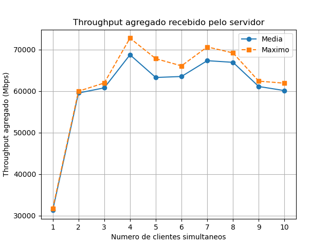

# Relatório Técnico – Capacidade Máxima de Transmissão de um Chat TCP

**Disciplina:** _______  **Aluno(s):** _______  **Data:** _______

## 1. Objetivo
Medir a taxa de transmissão agregada (clientes → servidor) de um chat TCP em C com 1 a 10 clientes simultâneos.

## 2. Ambiente utilizado
| Item | Valor |
|---|---|
| Processador | |
| Memória RAM | |
| Sistema operacional | Ubuntu (WSL2) sobre Windows ___ |
| Compilador | gcc ___ (`gcc chat_server.c -o chat_server -lpthread`) |
| Rede | loopback (127.0.0.1), servidor e clientes na mesma máquina |
| Outras características | |

## 3. Modificações no código
- **Servidor:** novo modo `teste`. Espera N clientes conectarem, cria uma thread por cliente que só faz `recv()` e soma os bytes recebidos em uma variável global protegida por mutex.
- **Cliente:** novo modo `teste`. Envia blocos de tamanho fixo continuamente por um tempo definido, sem digitação.
- **Python (`teste_automatico.py`):** sobe servidor e N clientes automaticamente, repete os testes e salva `resultados.csv`.

## 4. Metodologia
| Parâmetro | Valor |
|---|---|
| Tamanho do bloco | 65536 bytes |
| Aquecimento (descartado) | 3 s |
| Duração da medição | 15 s |
| Repetições por cenário | 5 |
| Clientes | 1 a 10 |

Para os resultados serem comparáveis: mesma máquina e configurações em todos os testes; os clientes continuam enviando além da janela de medição; os primeiros segundos (conexão e aquecimento) são descartados; pausa entre as repetições; medições em que algum cliente caiu são ignoradas; programas pesados foram fechados durante os testes.

## 5. Cálculo da taxa agregada
O servidor soma, em uma variável global (com mutex), os bytes recebidos por todas as threads. Após o aquecimento, anota `bytes_ini` e o tempo `t_ini`; passados 15 s, anota `bytes_fim` e `t_fim`:

**Mbps = (bytes_fim − bytes_ini) × 8 / (t_fim − t_ini) / 1 000 000**

Só contam os bytes efetivamente recebidos pelo servidor (retorno do `recv()`). O tempo é medido com `gettimeofday()`.

## 6. Resultados

| Clientes | Repetições | Média (Mbps) | Desvio | Mínimo | Máximo | Média por cliente |
|---:|---:|---:|---:|---:|---:|---:|
| 1 | | | | | | |
| 2 | | | | | | |
| 3 | | | | | | |
| 4 | | | | | | |
| 5 | | | | | | |
| 6 | | | | | | |
| 7 | | | | | | |
| 8 | | | | | | |
| 9 | | | | | | |
| 10 | | | | | | |

## 7. Discussão
_(Como o throughput agregado mudou de 1 para 10 clientes? Aumentou, estabilizou ou caiu? Em que ponto saturou? A taxa por cliente caiu?)_

## 8. Limites e gargalos
_(CPU, troca de contexto entre threads, mutex compartilhado, clientes e servidor na mesma máquina, WSL2, tamanho do bloco. Como foi loopback, o limite é de CPU/software e não da placa de rede.)_

## 9. Códigos
- Servidor: https://github.com/_____
- Cliente: https://github.com/_____

Compilação e execução: ver README.md.

## 10. Conclusão
_(...)_
